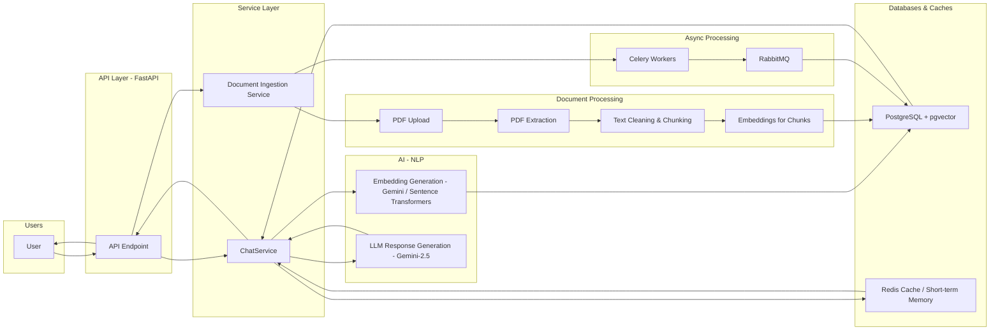

# RAGVault – Retrieval Augmented PDF Question Answering System

## Overview

RAGVault is a **session-isolated Retrieval Augmented Generation (RAG) platform** designed to allow users to upload documents and ask contextual questions grounded strictly in those documents.

The system extracts structured information from PDFs, converts the content into embeddings, stores them in a vector-enabled PostgreSQL database, and retrieves relevant chunks during query time to generate accurate answers using an LLM.

The architecture is designed to be **modular, scalable, and production-ready**, supporting multi-user access, session isolation, hybrid search, and asynchronous document processing.

---

## Table of Contents

- [Overview](#overview)
- [Project Objective](#project-objective)
- [Key Features](#key-features)
  - [Multi-User Authentication](#multi-user-authentication)
  - [Session Based Chat](#session-based-chat)
  - [Document Upload & Processing](#document-upload--processing)
  - [Advanced Retrieval System](#advanced-retrieval-system)
  - [Conversational Q&A](#conversational-qa)
  - [Scalable Architecture](#scalable-architecture)
- [Technology Stack](#technology-stack)
  - [Backend](#backend)
  - [AI / NLP](#ai--nlp)
  - [Document Processing](#document-processing)
  - [Vector Storage](#vector-storage)
- [System Architecture](#system-architecture)
  - [API Layer](#api-layer)
  - [Service Layer](#service-layer)
  - [Repository Layer](#repository-layer)
  - [Database Layer](#database-layer)
  - [Retrieval Architecture](#retrieval-architecture)
  - [Asynchronous Processing](#asynchronous-processing)
  - [Memory Architecture](#memory-architecture)
    - [Short-Term Memory](#short-term-memory)
    - [Long-Term Memory](#long-term-memory)
  - [Security Architecture](#security-architecture)
- [Scalability Considerations](#scalability-considerations)
- [Observability and Monitoring (Future Scope)](#observability-and-monitoring-future-scope)
- [Installation & Setup](#installation--setup)
  - [Prerequisites](#prerequisites)
  - [Running the App](#running-the-app)
- [Summary](#summary)

# Project Objective

The primary objective of this project is to build a **reliable document-grounded question answering system** that:

- Prevents hallucinated responses
- Maintains strict session-level document isolation
- Provides high-quality retrieval using hybrid search
- Supports conversational memory
- Scales for large document ingestion pipelines

The system ensures that **answers are generated exclusively from the retrieved document context**.

---

# Key Features

## Multi-User Authentication
- Secure user registration and login
- JWT-based authentication
- Refresh token session management

## Session Based Chat
- Each user can create multiple chat sessions
- Documents and conversations are isolated per session
- No cross-session data leakage

## Document Upload & Processing
- Upload PDF documents
- Automatic extraction and preprocessing
- Chunk generation and embedding creation
- Vector indexing in PostgreSQL

## Advanced Retrieval System
- Hybrid search combining:
  - Vector similarity
  - Full-text search
  - Keyword matching
- Ranking based on weighted scoring

## Conversational Q&A
- Context retrieval from session documents
- Conversation memory preservation
- Hallucination guard prompts

## Scalable Architecture
- Asynchronous document ingestion
- Modular pipeline architecture
- Repository pattern and service layer separation

---

# Technology Stack

## Backend
- FastAPI
- PostgreSQL
- Redis
- Celery
- RabbitMQ
- Poetry (dependency management)

## AI / NLP
- Gemini Embedding Model (`gemini-embedding-001`)
- Gemini LLM (`gemini-2.5-flash-lite`)
- Sentence Transformers (optional fallback)

## Document Processing
- PyMuPDF
- pdfplumber

## Vector Storage
- pgvector extension for PostgreSQL

---

# System Architecture

The RAGVault system follows a **layered and modular architecture** designed for scalability, maintainability, and clear separation of concerns. Each component is responsible for a specific responsibility, allowing the system to evolve without tightly coupling services.

Below is a **high-level architecture diagram** showing all major components, including API, Service Layer, databases, Redis, LLM, and the document ingestion pipeline.


<!-- The architecture is structured around **four primary layers**. -->

---

## API Layer

The API layer is responsible for handling all external requests.  
It exposes REST endpoints and performs request validation, authentication checks, and response formatting.

This layer does not contain business logic. Instead, it delegates work to the service layer.

Responsibilities include:

- Handling HTTP requests and responses
- Validating request schemas
- Performing authentication and authorization
- Returning standardized API responses

Key technologies used in this layer include **FastAPI and Pydantic**.

---

## Service Layer

The service layer contains the **core business logic** of the application.  
It orchestrates different components such as repositories, embedding pipelines, retrieval systems, and LLM interactions.

Services act as the central coordinator of operations and enforce business rules.

Examples of service responsibilities include:

- Managing chat sessions
- Processing uploaded documents
- Running the ingestion pipeline
- Generating embeddings
- Performing document retrieval
- Constructing prompts for the LLM
- Persisting chat messages

This layer ensures that controllers remain lightweight and that the database layer remains focused purely on persistence.

---

## Repository Layer

The repository layer is responsible for **database access and persistence operations**.

Repositories abstract the database queries and provide reusable data access methods to the service layer.

Responsibilities include:

- CRUD operations
- Vector similarity queries
- Hybrid search queries
- Session and document management
- Chat message persistence

By isolating database access in repositories, the architecture ensures that changes to the data storage layer do not impact business logic.

---

## Database Layer

The database layer provides persistent storage for users, sessions, documents, embeddings, and chat history.

PostgreSQL is used as the primary database, extended with the **pgvector extension** to enable vector similarity search.

Redis is used for caching and short-term memory to improve performance.

Stored data includes:

- User information
- Authentication sessions
- Chat sessions
- Uploaded document metadata
- Document chunks and embeddings
- Chat conversation history

---


## Retrieval Architecture

The retrieval system uses a **hybrid search strategy** to maximize context relevance.

The system combines three signals:

Vector similarity  
Full-text search ranking  
Keyword matching

Each signal contributes to a weighted relevance score.

The hybrid ranking formula is defined as:

    score = 0.65 * vector_similarity 
            0.25 * text_rank 
            0.10 * keyword_match

This approach significantly improves retrieval accuracy compared to using vector search alone.

---

## Asynchronous Processing

Document ingestion and embedding generation are computationally expensive operations.  
To avoid blocking API requests, these tasks are executed asynchronously.

Celery workers handle background jobs such as:

- Document processing
- Embedding generation
- Chunk storage

RabbitMQ acts as the message broker for task distribution.

This architecture ensures that the system remains responsive even during large document ingestion workloads.

---

## Memory Architecture

The chat system maintains two levels of memory.

### Short-Term Memory

Short-term memory is stored in Redis and is used to quickly retrieve recent conversation messages.

This enables efficient multi-turn conversations.

### Long-Term Memory

All chat messages are persisted in PostgreSQL for historical retrieval and session continuity.

Using both layers allows the system to balance **performance and persistence**.

---

## Security Architecture

Security is implemented across multiple layers of the system.

Authentication is handled using JWT tokens.

Passwords are securely hashed using bcrypt.

Sessions are isolated per user, ensuring that documents and chats cannot be accessed across users.

Additional protections include:

- Input validation
- Rate limiting (optional future enhancement)
- Secure API token handling
- Session ownership verification

---

## Scalability Considerations

The system is designed with scalability in mind.

Key scalability strategies include:

- Stateless API services
- Background processing with Celery
- Redis caching
- Session-isolated vector retrieval
- Efficient hybrid search queries
- Chunk-based document indexing

The architecture supports horizontal scaling by deploying multiple API workers and Celery workers.

---

## Observability and Monitoring (Future Scope)

The architecture allows integration with observability tools such as:

- Prometheus
- Grafana
- OpenTelemetry
- Structured logging pipelines

This ensures that system performance and failures can be monitored effectively in production environments.

---

#  Installation & Setup

## Prerequisites

Before running the project, ensure you have:

- Python 3.11+
- Poetry >= 1.5.1
- Redis
- PostgreSQL

## Running the App

1. **Install dependencies**  
```bash
poetry install
```

2. **Activate the virtual environment**  
```bash
poetry shell
```

3. **Start application**  
```bash
python start.py
```

---

## Summary

The RAGVault architecture is designed to support a **robust document intelligence platform** capable of handling large-scale document ingestion and conversational question answering.

By combining:

- modular architecture
- hybrid retrieval
- structured ingestion pipelines
- asynchronous processing
- session-based isolation

the system delivers reliable, scalable, and context-aware responses grounded in user-provided documents.


---

## Contributing & Feedback

We welcome contributions, suggestions, and feedback to make **RAGVault** even better!  

- ⭐ **Star the repository** if you find it useful  
- 🐛 **Report issues** via GitHub Issues for bugs or feature requests  
- 💬 **Share feedback** or ask questions by emailing: [prajapatjinesh585@gmail.com](mailto:prajapatjinesh585@gmail.com)  
- 🤝 **Contribute**: Fork the repo, make improvements, and submit a pull request  

---

Thank you for exploring **RAGVault**! Your support helps improve the platform and build better document-grounded AI tools. 🚀